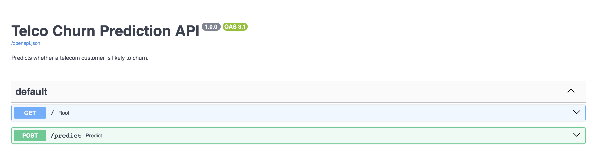
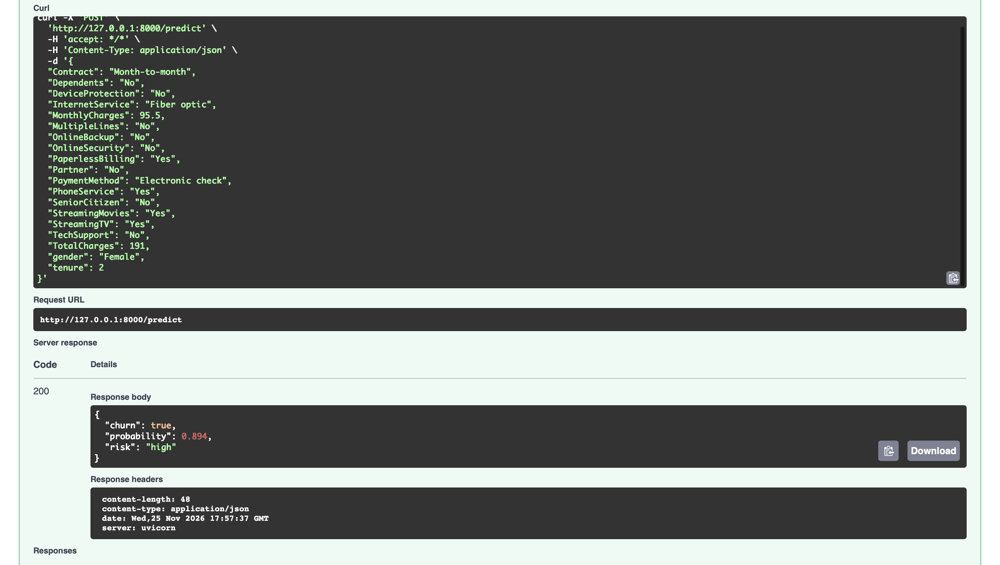

# Telco Customer Churn Prediction API

A machine learning service that predicts whether a telecom customer is likely to churn (leave the operator).
The model is served through a **FastAPI** REST API and packaged in a **Docker** container.

**Business context:** keeping a customer costs less than winning a new one. The service gives each customer a churn probability and a risk level (`low` / `medium` / `high`), so the retention team can see whom to contact first.

## Tech stack

`Python` · `pandas` · `scikit-learn` · `FastAPI` · `Pydantic` · `Uvicorn` · `Docker` · `Git`

## Dataset

[Telco Customer Churn](https://www.kaggle.com/datasets/blastchar/telco-customer-churn) (IBM sample dataset):

- 7,043 customers and 19 features: demographics, services, contract type, billing and charges.
- Target: `Churn` (Yes/No). The classes are imbalanced: about 26.5% of customers churned.

## Model

- **Preprocessing:** `StandardScaler` for numeric features and `OneHotEncoder` for categorical ones. Both sit inside a scikit-learn `Pipeline`, so the API accepts raw customer data.
- **Algorithm:** Logistic Regression with `class_weight="balanced"` to handle class imbalance.
- **Validation:** stratified 80/20 train/test split.

| Metric | Score |
|---|---|
| ROC-AUC | **0.842** |
| Recall (churn) | **0.783** |
| Precision (churn) | 0.504 |
| F1 (churn) | 0.614 |
| Accuracy | 0.738 |

Recall is the priority metric. Missing a churning customer costs more than sending a retention offer to a customer who would have stayed.

## Project structure

```
telco-churn-prediction/
├── data/
│   └── WA_Fn-UseC_-Telco-Customer-Churn.csv
├── train.py           # trains the model and saves model.joblib
├── main.py            # FastAPI app
├── model.joblib       # trained model (sklearn Pipeline)
├── metrics.json       # evaluation metrics
├── requirements.txt   # dependencies
├── Dockerfile         # container instructions
├── .dockerignore
└── README.md
```

## API endpoints

| Method | Endpoint | Description |
|---|---|---|
| GET | `/` | Health check: `{"message": "ML API is running"}` |
| POST | `/predict` | Returns the churn prediction for one customer |
| GET | `/docs` | Interactive Swagger UI |

**Example request:**

```json
{
  "gender": "Female",
  "SeniorCitizen": "No",
  "Partner": "No",
  "Dependents": "No",
  "tenure": 2,
  "PhoneService": "Yes",
  "MultipleLines": "No",
  "InternetService": "Fiber optic",
  "OnlineSecurity": "No",
  "OnlineBackup": "No",
  "DeviceProtection": "No",
  "TechSupport": "No",
  "StreamingTV": "Yes",
  "StreamingMovies": "Yes",
  "Contract": "Month-to-month",
  "PaperlessBilling": "Yes",
  "PaymentMethod": "Electronic check",
  "MonthlyCharges": 95.5,
  "TotalCharges": 191.0
}
```

**Example response:**

```json
{
  "churn": true,
  "probability": 0.894,
  "risk": "high"
}
```

Input is validated with Pydantic. Invalid values, such as an unknown contract type or a negative tenure, get an HTTP `422` error back.

## How to run

### 1. Locally

```bash
python3 -m venv venv
source venv/bin/activate          # Windows: venv\Scripts\activate
pip install -r requirements.txt

python train.py                   # train and save the model
uvicorn main:app --reload         # start the API
```

Then open http://127.0.0.1:8000/docs.

### 2. With Docker

```bash
docker build -t telco-churn-api .
docker run -d -p 8000:8000 --name churn-api telco-churn-api
```

Then open http://127.0.0.1:8000/docs.

To stop and remove the container:

```bash
docker stop churn-api && docker rm churn-api
```

## Screenshots

| Swagger UI | Prediction (Docker) |
|---|---|
|  |  |

## SIS-3: Streamlit + MLflow

- `train_mlflow.py` trains 4 models (2× Logistic Regression, Random Forest, Gradient Boosting) and logs params, metrics and the model artifact to the MLflow experiment `telco-churn`.
- The best model by F1 (Random Forest) is registered in the MLflow Model Registry as `telco-churn-model` with the alias `@champion`.
- `app.py` is a Streamlit UI that calls the FastAPI `/predict` endpoint and shows churn risk + retention offers (Next Best Offer).

Run:
pip install -r requirements-dev.txt
mlflow ui --backend-store-uri sqlite:///mlflow.db --port 5001
python train_mlflow.py
uvicorn main:app --reload
streamlit run app.py